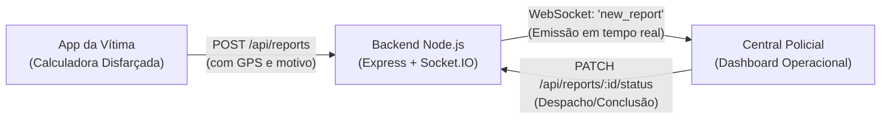

# Sistema Integrado de Denúncia Disfarçada e Atendimento Policial

Sistema completo composto por **duas aplicações independentes** (App da Vítima e Central Policial) integradas em tempo real por um **servidor backend** via API REST e WebSockets (Socket.IO).

---

## 🏗️ Arquitetura do Sistema

```text
denuncia-disfarcada-ionic/
├── app-vitima/      # Aplicação móvel disfarçada da mulher (Porta 8100)
├── app-policia/     # Central de monitoramento e despacho de viaturas (Porta 8200)
└── backend/         # Servidor Node.js / Express + WebSockets (Porta 3001)
```



---

## 📱 1. App da Vítima (`app-vitima`)

- **Fachada Segura**: Opera como uma calculadora real no dia a dia.
- **Desbloqueio Sigiloso**: Digitando `1 + 10 =`, a interface revela imediatamente o **Canal Seguro de Atendimento**.
- **Geolocalização Exata**: Captura coordenadas via GPS (`@capacitor/geolocation`) e gera a rota direta para o Google Maps.
- **Saída Rápida**: Botão de emergência que redireciona instantaneamente a tela para o Google.
- **Transmissão Imediata**: Ao submeter a denúncia, envia os dados criptografados para o backend dos policiais.

---

## 🚓 2. Central Policial (`app-policia`)

- **Monitoramento em Tempo Real**: Conexão WebSocket com indicador de status ao vivo.
- **Recepção Instantânea**: Quando uma vítima envia a denúncia no app dela, o chamado surge imediatamente na tela dos policiais sem necessidade de atualizar a página.
- **Ações Operacionais**:
  - Abertura de coordenadas no Google Maps.
  - Despacho de viatura (*Em Atendimento*).
  - Finalização do chamado (*Concluído*).
  - Abertura manual de ocorrências (para chamados recebidos pelo 190 ou rádio).

---

## ⚙️ 3. Backend Central (`backend`)

- Desenvolvido em **Node.js** com **Express**, **CORS** e **Socket.IO**.
- Disponibiliza:
  - `GET /api/reports`: Retorna a lista de ocorrências.
  - `POST /api/reports`: Recebe uma denúncia e transmite o evento `new_report` para todos os terminais policiais conectados.
  - `PATCH /api/reports/:id/status`: Atualiza a situação do atendimento e notifica as viaturas conectadas.

---

## 🚀 Como Executar o Sistema Completo

Para testar o fluxo em tempo real, execute os 3 módulos (cada um em um terminal diferente):

### 1º Terminal: Iniciar o Backend
```bash
cd backend
npm run dev
```
> O servidor iniciará em `http://localhost:3001`.

### 2º Terminal: Iniciar a Central Policial
```bash
cd app-policia
npm run dev
```
> A Central Policial abrirá em `http://localhost:8200`.

### 3º Terminal: Iniciar o App da Vítima
```bash
cd app-vitima
npm run dev
```
> O aplicativo da vítima abrirá em `http://localhost:8100`.

---

## 🧪 Teste de Comunicação em Tempo Real

1. Abra a **Central Policial** (`http://localhost:8200`) e observe o indicador *"Tempo Real Ativo"*.
2. Em outra aba ou janela, abra o **App da Vítima** (`http://localhost:8100`).
3. Na calculadora, digite:
   ```text
   1 + 10 =
   ```
4. No Canal Seguro, permita a localização e clique em **Enviar denúncia para a polícia**.
5. Observe a tela da Central Policial: **o novo chamado surge na mesma hora na fila dos policiais!**
